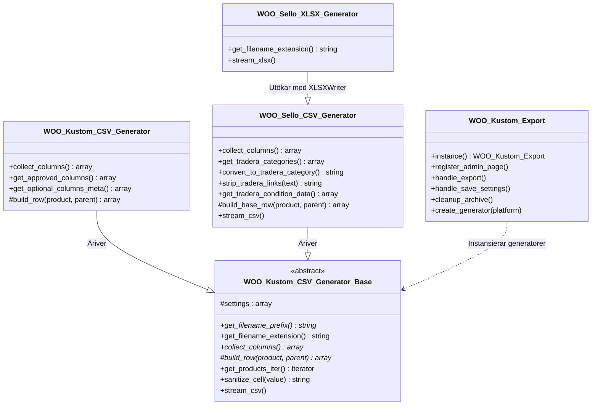

# WooCommerce Product Export (Kustom POS & Sello Tradera)

Ett professionellt, minneseffektivt WordPress/WooCommerce-plugin utvecklat av **Linthor Webbyrå** för att exportera produktkataloger (enkla och variabla produkter) direkt anpassade för bulkimport i **Kustom POS** (kassasystem) och **Sello** (för vidare synkning till **Tradera** butiksförsäljning).

Pluginet stödjer export till både **CSV** (RFC 4180 med UTF-8 BOM och CSV-injectionskydd) och äkta **Excel (.xlsx)** via strömmande XLSX-generering.

---

## Innehållsförteckning

1. [Översikt & Huvudfunktioner](#översikt--huvudfunktioner)
2. [Systemkrav](#systemkrav)
3. [Fil- och Katalogstruktur](#fil--och-katalogstruktur)
4. [Arkitektur & Klasshierarki](#arkitektur--klasshierarki)
5. [Plattformsspecifik Logik](#plattformsspecifik-logik)
   - [Kustom POS](#1-kustom-pos-csv)
   - [Sello & Tradera](#2-sello--tradera-csv--xlsx)
6. [Utvecklingsmiljö & Byggprocess](#utvecklingsmiljö--byggprocess)
7. [Guide: Hur du bygger vidare](#guide-hur-du-bygger-vidare)
8. [Databas & Schemalagda jobb (Cron)](#databas--schemalagda-jobb-cron)
9. [Säkerhet & Minneshantering](#säkerhet--minneshantering)
10. [Felsökning & Vanliga Fallgropar](#felsökning--vanliga-fallgropar)

---

## Översikt & Huvudfunktioner

- **Kustom POS CSV-export**:
  - Exporterar med Kustoms fyra obligatoriska kärnkolumner (`product_name`, `price_including_vat`, `vat_rate`, `currency`).
  - Interaktiv fältväljare för alla standard WooCommerce-fält (SKU, EAN/streckkod, lagersaldo, beskrivning, mått, etc.).
  - Dynamiskt stöd för valfria och globala produktattribut som egna kolumner.
  - Varje variation exporteras som en egen rad med föräldrakoppling och unikt SKU.
- **Sello & Tradera-export (CSV & XLSX)**:
  - 13 officiella kolumner för Tradera fastprisbutik: `Sku`, `Standard name sv`, `Standard description sv`, `Tradera category`, `Tradera price store`, `Purchase price`, `Quantity`, `Tax`, `Weight`, `Images`, `Brand`, `Group sku`, `Condition`.
  - **Tradera Category Mapping**: Automatisk matchning av WooCommerce-kategorier mot Traderas officiella kategoriträd via `includes/data/tradera-categories.csv`.
  - **Condition (Skickhantering)**: Mappar automatiskt WooCommerce-skick till Sellos officiella `Condition` (`new` eller `used`) och placerar detaljerat skick (t.ex. *Gott skick*) i produktbeskrivningen.
  - **Tradera Link Stripper**: Rensar automatiskt bort otillåtna externa länkar, domäner (t.ex. `glasprinsen.se`) och butiksreferenser för att uppfylla Traderas strikta regelverk.
  - **Tradera butikspris**: Mappar heltalsbelopp (t.ex. `495`) i `Tradera price store` och exkluderar `Price` / `Calculate` för att förhindra oönskad prisberäkning i Sello.
  - **Filter**: Exporturval baserat på skick (t.ex. endast Vintage eller Nya) och/eller varumärkesfilter.
- **Admin UI & Verktyg**:
  - Modernt gränssnitt byggt med Tailwind CSS.
  - Fliknavigering (Dashboard, Kustom POS, Sello Tradera, Handböcker).
  - Live förhandsgranskning och datavalidering i realtid (varnar om SKU eller pris saknas före export).
  - Filarkiv med automatisk rensning efter 30 dagar via WP-Cron.
  - Integrerade PDF-manualer i `/docs/`.

---

## Systemkrav

- **WordPress**: 5.8 eller senare.
- **WooCommerce**: 5.0 eller senare.
- **PHP**: 7.4 eller senare (PHP 8.0, 8.1, 8.2 och 8.3 stöds fullt ut).
  - `php-zip` / `ZipArchive` (krävs för att generera Excel `.xlsx`-filer).
  - `mbstring` (för säker stränghantering och UTF-8 sanering).
- **Node.js**: >= 18.0.0 och npm (för CSS-kompilering och paketering av distributions-zip).

---

## Fil- och Katalogstruktur

```text
Woocommerce-to-import-kustom/
├── assets/
│   ├── admin.css                   # Minifierad admin-CSS (kompilerad via Tailwind)
│   └── admin.js                    # Admin JS (flikhantering, AJAX-inställningar, validering)
├── bin/
│   └── build-zip.js                # Byggskript för deterministisk, OS-oberoende plugin-zip
├── docs/
│   ├── Lathund-kustom.pdf          # Användarguide för Kustom POS
│   ├── lathund-sello.pdf           # Användarguide för Sello & Tradera
│   └── index.php                   # Tysthetsskydd
├── includes/
│   ├── class-woo-kustom-export.php # Huvudkontroller (Admin UI, router, AJAX, arkiv, cron)
│   ├── class-woo-kustom-csv-generator-base.php # Abstrakt basklass för exportgeneratorer
│   ├── class-woo-kustom-csv-generator.php      # Kustom POS CSV-generator
│   ├── class-woo-sello-csv-generator.php       # Sello Tradera CSV-generator & logik
│   ├── class-woo-sello-xlsx-generator.php      # Sello Tradera XLSX-generator (strömmad)
│   ├── data/
│   │   └── tradera-categories.csv  # Databas över Traderas officiella kategorier och ID:n
│   └── lib/
│       └── xlsxwriter.class.php    # Standalone PHP-bibliotek för snabb, minnessnål XLSX-skrivning
├── src/
│   └── css/
│       └── admin.css               # Käll-CSS med Tailwind-direktiv och admin-specifika klasser
├── .gitattributes
├── .gitignore
├── package.json                    # npm-scripts och dev-beroenden
├── postcss.config.js               # PostCSS-konfiguration (Tailwind, Autoprefixer, prefix-selector)
├── readme.txt                      # WordPress.org standard plugin-readme
├── tailwind.config.js              # Tailwind CSS-konfiguration
└── woo-kustom-export.php           # Pluginets huvudfil (bootstrap & hooks)
```

---

## Arkitektur & Klasshierarki



### 1. `WOO_Kustom_Export` (`includes/class-woo-kustom-export.php`)
- **Singleton** som initieras via `plugins_loaded` i `woo-kustom-export.php`.
- Registrerar menyfliken `WooCommerce` → `Produkt-export` (kräver capability `manage_woocommerce`).
- Hanterar HTTP POST/GET-endpoints för nedladdning via `admin-post.php`:
  - `admin_post_woo_kustom_export_download`: Genererar och strömmar exportfiler.
  - `admin_post_woo_kustom_export_download_archive`: Hämtar tidigare sparad exportfil från disk.
  - `admin_post_woo_kustom_export_delete_archive`: Raderar fil från arkivet.
  - `admin_post_woo_kustom_export_save_settings`: Sparar inställningar via AJAX eller vanlig form submit.
- Sköter automatisk daglig schemaläggning via WP-Cron (`woo_kustom_export_cleanup_archive`) för att rensa arkiverade exportfiler äldre än 30 dagar.

### 2. `WOO_Kustom_CSV_Generator_Base` (`includes/class-woo-kustom-csv-generator-base.php`)
- Abstrakt bas för samtliga exportformat.
- Implementerar **PHP-generatorer / iteratorer** (`get_products_iter()`) som hämtar produkter i chunkade batcher via `wc_get_products()`. Detta förhindrar att PHP överskrider `memory_limit` oavsett katalogstorlek.
- Skriver ut data enligt **RFC 4180**:
  - Avgränsare: komma (`,`).
  - Celler omsluts av citationstecken (`"`) vid behov.
  - UTF-8 BOM (`\xEF\xBB\xBF`) skrivs i början av filen för att Excel på Windows ska tolka å, ä, ö och emojis korrekt.
  - Skydd mot **CSV Injection** (`sanitize_cell()`): celler vars innehåll inleds med `=`, `+`, `-` eller `@` förses med en inledande apostrof `'`.

### 3. `WOO_Kustom_CSV_Generator` (`includes/class-woo-kustom-csv-generator.php`)
- Specialiserad för **Kustom POS**.
- Håller reda på obligatoriska kolumner (`product_name`, `price_including_vat`, `vat_rate`, `currency`) samt valbara WooCommerce-fält.
- Upptäcker och listar alla globala attribut (`wc_get_attribute_taxonomies()`) samt unika anpassade produktattribut via `attribute_cache`.

### 4. `WOO_Sello_CSV_Generator` (`includes/class-woo-sello-csv-generator.php`)
- Specialiserad för **Sello & Tradera**.
- Sköter formatering av priser som heltal utan valuta i `Tradera price store`.
- Sköter `Condition` (`new` / `used`) och lägger till utförlig skickgradering i beskrivningen.
- Innehåller **Tradera Link Stripper** (`strip_tradera_links()`) med regex-motor för att ta bort butikslänkar, domännamn och säljuppmaningar.
- Innehåller **Tradera Category Matcher** (`convert_to_tradera_category()`) som matchar mot `includes/data/tradera-categories.csv`.

### 5. `WOO_Sello_XLSX_Generator` (`includes/class-woo-sello-xlsx-generator.php`)
- Ärver från `WOO_Sello_CSV_Generator`.
- Återanvänder exakt samma databyggarlogik och kolumner som CSV-generatorn, men genererar en giltig `.xlsx`-fil med formaterade kolumntyper (text, tal, valuta) via `includes/lib/xlsxwriter.class.php`.

---

## Plattformsspecifik Logik

### 1. Kustom POS CSV

| Kolumn | Typ | Beskrivning |
| :--- | :--- | :--- |
| `product_name` | Obligatorisk | Produktens titel. För varianter inkluderas variationsattribut (t.ex. "Skjorta - Blå, M"). |
| `price_including_vat`| Obligatorisk | Försäljningspris inklusive moms med 2 decimaler (punkt som decimaltecken). |
| `vat_rate` | Obligatorisk | Momssats i procent utan %-tecken (t.ex. `25`, `12`, `6`, `0`). |
| `currency` | Obligatorisk | Valutakod i ISO 4217 (hämtas via `get_woocommerce_currency()`, t.ex. `SEK`). |
| *Valbara kolumner* | Valfritt | `sku`, `product_id`, `parent_sku`, `description`, `category`, `ean`, `image_url` m.fl. |
| *Attribut* | Valfritt | Egen kolumn per valt WooCommerce-attribut (t.ex. `Färg`, `Storlek`, `Material`). |

> [!WARNING]
> Kustom POS ersätter befintliga produkter i samma butik vid bulkimport om SKU matchar. Informera alltid butiksadministratören att göra en backup innan import sker i Kustom.

---

### 2. Sello & Tradera (CSV / XLSX)

Sello Tradera-formatet har 13 dedikerade kolumner:

1. **`Sku`**: Artikelnummer (unikt för varje produkt eller variation).
2. **`Standard name sv`**: Produktnamn (tvättat från eventuella butikslänkar och HTML).
3. **`Standard description sv`**: Ren textbeskrivning utan HTML/kortkoder, kompletterad med skickangivelse (t.ex. *Skick: Gott skick*).
4. **`Tradera category`**: Numeriskt Tradera-kategori-ID eller kategorisökväg (matchat mot `tradera-categories.csv`).
5. **`Tradera price store`**: Butikspris på Tradera. Exporteras som **avrundat heltal utan valuta** (t.ex. `495`).
6. **`Purchase price`**: Inköpspris (om det finns sparat i produktens metadata, annars tomt).
7. **`Quantity`**: Lagersaldo.
8. **`Tax`**: Momssats (`25`, `12`, `6`, `0`).
9. **`Weight`**: Vikt angiven i gram (omräknas automatiskt från butikens viktenhet i WooCommerce).
10. **`Images`**: Fullständiga HTTPS-URL:er till produktbilder, separerade med komma.
11. **`Brand`**: Varumärke (hämtas från taxonomi som `pa_brand`, `pwb-brand`, `yith_product_brand` eller meta).
12. **`Group sku`**: Förälderns SKU för produktvarianter (grupperar artiklarna i Sello).
13. **`Condition`**: Sellos officiella skickvärde: **`new`** (för oanvänt) eller **`used`** (för vintage/begagnat).

> [!IMPORTANT]
> Kolumnerna `Price` och `Calculate` **utelämnas avsiktligt** för Sello Tradera-exporten. Om `Price` skickas med försöker Sello beräkna `Tradera price store` med egna marginalregler, vilket ofta leder till felaktiga priser på Tradera.

---

## Utvecklingsmiljö & Byggprocess

Pluginet använder Node.js och Tailwind CSS för administrationsgränssnittets styling, samt ett specialskrivet skript för paketering.

### 1. Installera beroenden

```bash
npm install
```

### 2. Utveckla och kompilera CSS

Källfilen ligger i [`src/css/admin.css`](file:///c:/Users/NoelPersson/Documents/GitHub/Woocommerce-to-import-kustom/src/css/admin.css) och kompileras till [`assets/admin.css`](file:///c:/Users/NoelPersson/Documents/GitHub/Woocommerce-to-import-kustom/assets/admin.css) med `postcss-prefix-selector` så att stilarna isoleras under `.woo-kustom-export-wrap` och inte påverkar övriga delar av WordPress Admin.

```bash
# Bygg CSS en gång med minifiering
npm run build:css

# Bevaka ändringar under utveckling
npm run watch:css
```

### 3. Bygg produktionsklar installations-ZIP

```bash
npm run plugin-zip
```

Detta kör `build:css` och därefter [`bin/build-zip.js`](file:///c:/Users/NoelPersson/Documents/GitHub/Woocommerce-to-import-kustom/bin/build-zip.js). Skriptet bygger `woo-kustom-export.zip` direkt enligt ZIP-specifikationen (STORE-metoden, inga OS-beroenden) med standardiserade snedstreck (`/`). Detta förhindrar vanliga Windows/PowerShell-fel som *"Incompatible Archive"* vid installation via WordPress Admin.

---

## Guide: Hur du bygger vidare

### Scenario 1: Lägga till ett nytt valbart fält i Kustom POS

1. Öppna [`includes/class-woo-kustom-csv-generator.php`](file:///c:/Users/NoelPersson/Documents/GitHub/Woocommerce-to-import-kustom/includes/class-woo-kustom-csv-generator.php).
2. Lägg till fältets metadata i metoden `get_optional_columns_meta()`:
   ```php
   'custom_meta_key' => array(
       'label' => __( 'Min etikett', 'woo-kustom-export' ),
       'group' => 'product', // 'product', 'inventory' eller 'pricing'
       'desc'  => __( 'Förklaring av fältet', 'woo-kustom-export' ),
   ),
   ```
3. Hantera fältets utvärdering i `build_row()` i samma fil:
   ```php
   if ( ! empty( $this->optional_columns['custom_meta_key'] ) ) {
       $row[] = $product->get_meta( '_custom_meta_key', true );
   }
   ```

### Scenario 2: Lägga till ett nytt filter i Sello-exporten

1. Öppna [`includes/class-woo-kustom-export.php`](file:///c:/Users/NoelPersson/Documents/GitHub/Woocommerce-to-import-kustom/includes/class-woo-kustom-export.php) under `render_sello_tab()`.
2. Lägg till ett nytt HTML-formulärfält (t.ex. en dropdown eller kryssruta) inom inställningsformuläret.
3. Se till att fältet sparas i `handle_save_settings()`.
4. Öppna [`includes/class-woo-sello-csv-generator.php`](file:///c:/Users/NoelPersson/Documents/GitHub/Woocommerce-to-import-kustom/includes/class-woo-sello-csv-generator.php) och läs in inställningen i `__construct()`.
5. Implementera filtervillkoret i metoden `include_product( $product, $parent )`. Returnera `false` om produkten ska exkluderas från exporten.

### Scenario 3: Lägga till en helt ny exportplattform (t.ex. Fyndiq eller Google Shopping)

1. Skapa en ny generator-klass i `includes/`, t.ex. `class-woo-fyndiq-csv-generator.php`, som ärver från `WOO_Kustom_CSV_Generator_Base`.
2. Implementera de abstrakta metoderna:
   - `get_filename_prefix()`
   - `collect_columns()`
   - `build_row( $product, $parent )`
3. Registrera den nya plattformen i `WOO_Kustom_Export::get_platforms()` i [`includes/class-woo-kustom-export.php`](file:///c:/Users/NoelPersson/Documents/GitHub/Woocommerce-to-import-kustom/includes/class-woo-kustom-export.php):
   ```php
   'fyndiq' => array(
       'label'     => __( 'Fyndiq CSV', 'woo-kustom-export' ),
       'generator' => 'WOO_Fyndiq_CSV_Generator',
   ),
   ```
4. Inkludera klassfilen i `woo_kustom_export_bootstrap()` i [`woo-kustom-export.php`](file:///c:/Users/NoelPersson/Documents/GitHub/Woocommerce-to-import-kustom/woo-kustom-export.php).

### Scenario 4: Uppdatera Tradera-kategorier

Filen [`includes/data/tradera-categories.csv`](file:///c:/Users/NoelPersson/Documents/GitHub/Woocommerce-to-import-kustom/includes/data/tradera-categories.csv) innehåller mappingstabellen.
- Format per rad: `Kategori-ID,Kategorinamn/Sökväg`.
- Metoden `WOO_Sello_CSV_Generator::get_tradera_categories()` parsar denna fil och cachear den i minnet under exportkörningen.

---

## Databas & Schemalagda jobb (Cron)

### Options i `wp_options`

| Option Key | Typ | Beskrivning |
| :--- | :--- | :--- |
| `woo_kustom_export_settings` | `array` | Sparar alla inställningar (aktiva kolumner, standardvillkor för Sello, domäner för länkrensning, filterval). |
| `woo_kustom_export_archive_log` | `array` | Index över genererade filer som sparats i arkivet (filnamn, filstorlek, tidsstämpel, plattform, sökväg). |

### Schemalagda händelser (WP-Cron)

- **Hook**: `woo_kustom_export_cleanup_archive`
- **Intervall**: Dagligen (`daily`).
- **Funktion**: `WOO_Kustom_Export::cleanup_archive()`. Kontrollerar katalogen `wp-content/uploads/woo-kustom-export/archive/` och raderar filer äldre än 30 dagar, samt städar upp i `woo_kustom_export_archive_log`.

---

## Säkerhet & Minneshantering

1. **Behörighetskontroll & CSRF**:
   - Alla admin-vyer och POST-anrop kontrolleras mot `current_user_can( 'manage_woocommerce' )`.
   - Alla actions skyddas med nonces (`check_admin_referer` och `wp_verify_nonce`).
2. **Minnesvänlig strömning**:
   - Inga exportmetoder bygger gigantiska arrayer i minnet. Produkter hämtas i segment via PHP-generatorer och skrivs direkt ut till utdataströmmen (`php://output`) eller rad för rad till en temporär Excel-skrivare.
3. **Skydd av arkivfiler**:
   - Arkivkatalogen i `uploads/woo-kustom-export/archive/` skyddas med `.htaccess` (`Deny from all`) och en tom `index.php` för att hindra direkt webbåtkomst till känslig pris- och produktdata. Nedladdning kan endast ske via autentiserade WordPress-anrop med giltig nonce.

---

## Felsökning & Vanliga Fallgropar

- **ZipArchive saknas vid Excel-export**:
  - *Fel*: Meddelande om att PHP ZipArchive krävs.
  - *Åtgärd*: Aktivera `extension=zip` i serverns `php.ini` (standard i de flesta moderna PHP-miljöer).
- **Specialtecken (å, ä, ö) blir konstiga i Excel**:
  - *Orsak*: Excel kräver UTF-8 BOM för att automatiskt förstå teckentabellen i CSV-filer.
  - *Åtgärd*: Generatorn skriver automatiskt ut `\xEF\xBB\xBF`. Om filen redigeras i tredjepartsprogram, säkerställ att den sparas med UTF-8 with BOM.
- **Produkter saknas i exporten**:
  - Kontrollera flikens inställningar för "Inkludera utkast", "Inkludera privata produkter" och "Inkludera slut i lager".
  - Kontrollera om varumärkes- eller skickfilter är aktiverat på Sello-fliken.

---

## Licens & Författare

- **Skapare**: [Linthor Webbyrå](https://linthor.com)
- **Licens**: GPLv2 or later (GNU General Public License v2.0 eller senare)
